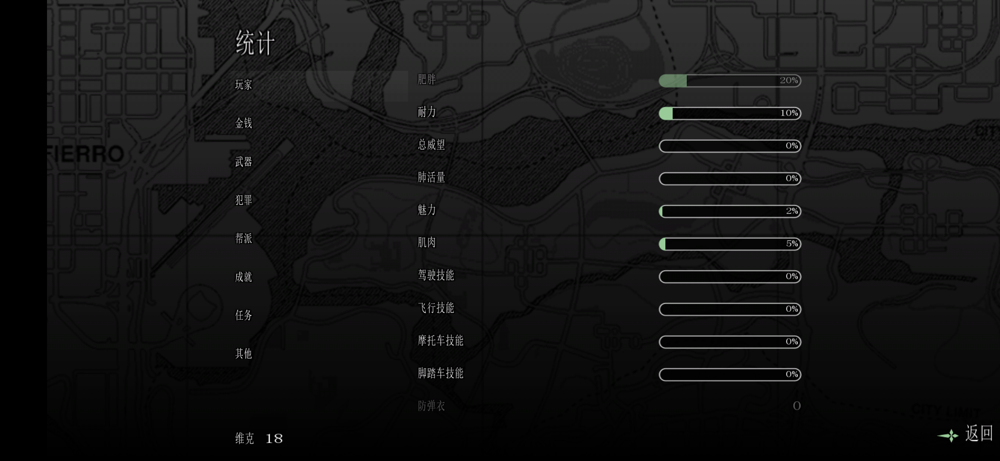

# GTASA_2013_CHS
适用于GTASA安卓版2.00的汉化方案
## 说明
- 仅适用于版本号为2.00的GTASA安卓端游戏主程序，其他版本以及Play端更新版本和模组专用的修改版本暂未做测试
- 内核汉化，不影响性能
- gxt未加密，可用第三方工具直接修改
- 和之前基于日语字库修改且字库容量严重受限（默认上限为1799）的拇指玩汉化版本相比，本项目将日语字库上限调节到4096字符，目前简中字库和英文字符共有3754个字符。
## 示例



# 程序编译
## 环境要求

| 依赖 | 版本 / 说明 |
|---|---|
| Python | 3.9+ |
| Pillow | 用于字体栅格化 |
| Android NDK | r26+（clang 17 验证通过） |
| 目标 ABI | `armeabi-v7a` |

### 需要自备的输入

| 文件 | 来源 |
|---|---|
| `libGTASA.so` | 你的 APK 内 `lib/armeabi-v7a/` |
| `american.gxt` | 你的 APK 内 `assets/Text/` |
| 中文 GXT | 本方案测试时使用无名汉化组制作的适用于 PC 版的汉化补丁 `wm_sachs.gxt`|
| 字体 | 任意 TTF/TTC，例如 `C:\Windows\Fonts\simsun.ttc` |

---

## 快速开始

```bash
git clone <repo> && cd GTASA_2013_CHS

# 1) 配置
cp config.example.json config.json
$EDITOR config.json          # 填入四个输入路径 + NDK bin 目录

# 2) 构建
python build.py
```

产物输出到 `out/`：

```
out/
├── libGTASA.so          11.7 MB   补丁后的链接库
├── libcnpatch.so         5.6 KB   字形数组扩容
├── japanese.gxt        763.4 KB   17,367 条，按 hash 升序
├── JapaneseFont.png      1.23 MB  2048*2048 图集
├── JapaneseFont.met     78.6 KB   2,597 条度量表
└── maptable.bin        127.9 KB   码位映射（已编入 .so，此处供留档）
```

构建是**可复现**的：相同输入产生逐字节相同的产物。

---

## 部署

**部署前请务必备份OBB数据包文件、原始 `libGTASA.so`/原版APK文件。**

- 用MT管理器打开APK文件：
- 将out产生的产物放入下列路径；
```
libs/libGTASA.so 
libs/libcnpatch.so 
assets/Texts/japanese.gxt
assets/Textures/fonts/JapaneseFont.met
assets/Textures/fonts/JapaneseFont.png
```
- 重新签名并卸载原先的游戏程序后重新安装打包后的APK文件；
- 恢复数据包并启动游戏；
- 滑动找到并点击`Options`-`Language Setup`，点击Japanese；
- 确保是中文后完成。
---

## 更换字体

```bash
python fonts/make_font.py <your_font_path> 0 out_msyh
```

参数：`<字体> [face索引] [输出目录] [字号]`

`.ttc` 是一个文件装多个字面，用 face 索引选择；工具会打印实际加载的字体名以便确认。

**换字体不需要重打 `libGTASA.so`。** 

```bash
python patch/repack_full.py out/maptable.bin
```

已验证字体：`simsun.ttc`（宋体）、`msyh.ttc`（微软雅黑）、`NotoSansCJK-Regular.ttc`。

## 许可

代码：[MIT](LICENSE)　文档：[CC BY 4.0](https://creativecommons.org/licenses/by/4.0/)
